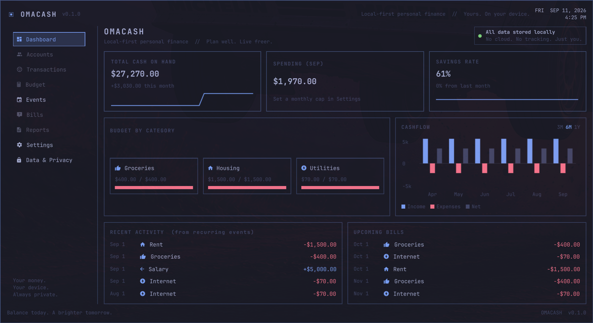

# Omacash

Local-first cashflow forecast for the [Omarchy](https://omarchy.org) desktop.



All data stored locally. No cloud. No tracking. Just you.

The bar pill is cash on hand. Click for a popover (this month, upcoming bills). Enter or right-click for the dashboard: KPIs, category spend, monthly cashflow, recurring events.

This is a desktop port of [macedot/cashflow](https://github.com/macedot/cashflow), packaged like [omastorm](https://github.com/wesleygrimes/omastorm). The window layout follows `docs/ui-reference.jpeg`; colors follow your Omarchy theme.

## Install

Omarchy 4.

```sh
omarchy plugin add https://github.com/macedot/omacash.git --enable
```

That clones into `~/.config/omarchy/plugins/com.omacash.cashflow` and asks which bar section to use. Update with `omarchy plugin update com.omacash.cashflow`.

To open the window from the keyboard, add one line to `~/.config/hypr/bindings.lua`. Omacash never writes that file.

```lua
o.bind("SUPER + SHIFT + K", "Omacash", "omarchy shell shell toggle com.omacash.cashflow '{}'")
```

## Use

Left-click the pill for the popover. Right-click or press Enter in the popover to expand. Esc closes.

| Key | Action |
| --- | --- |
| `g d` / `g e` / `g s` / `g p` | Dashboard / Events / Settings / Privacy |
| `n` | New event |
| `j` `k` | Move rows |
| `Enter` | Edit selected |
| `x` | Delete selected |
| `3` `6` `y` | Cashflow range 3M / 6M / 1Y |
| `c` | Cycle currency |
| `i` | Import CSV from `~/Downloads` |
| `e` | Export events to `~/Downloads/cashflow-events.csv` |
| `r` | Export results to `~/Downloads/cashflow-results.csv` |
| `?` | Keys sheet |
| `Esc` | Close |

Events are recurring income (positive) and expenses (negative). The dashboard charts those occurrences. It is not a bank feed.

CSV files default to `~/Downloads` (or `$XDG_DOWNLOAD_DIR`). Import auto-detects the header: events first (`cashflow-events.csv`), else results (`cashflow-results.csv`).

Events:

```csv
name,startDate,endDate,frequency,value,currency,category
Salary,2026-01-01,2026-12-31,monthly,5000,USD,Income
Rent,2026-01-01,,monthly,-1500,USD,Housing
```

Results (SPA `cashflow-results.csv` — daily cashflow and running balance for the Settings period):

```csv
Date,Cashflow,Balance,Items
2026-09-11,0.00,0.00,
2026-09-13,-50.00,-50.00,Grossery
2026-10-10,1850.00,1650.00,Salary; Rent; Bills
```

Importing a results file creates one-shot events (start = end = that date). Combined days stay one row; recurrences are not reconstructed.

## Configuration

`~/.config/omacash/config.toml`:

```toml
currency = "USD"
period = "1y"
initial_balance = 0
# monthly_spend_cap = 4000

[keys]
new_event = "n"
```

Events live in `~/.local/share/omacash/events.json`. UI restore is `~/.local/state/omacash/state.json`.

## Develop

```sh
bash scripts/plugin-link.sh
npm test
bash scripts/check.sh
```

`plugin-link.sh` symlinks this checkout into `~/.config/omarchy/plugins/com.omacash.cashflow` and restarts the shell.

## Remove

```sh
omarchy plugin remove com.omacash.cashflow
```

Your data stays until you delete it:

```sh
rm -rf ~/.config/omacash ~/.local/share/omacash ~/.local/state/omacash
```

## License

MIT. Simulation behavior is ported from cashflow (AGPL-3.0) by the same author.
